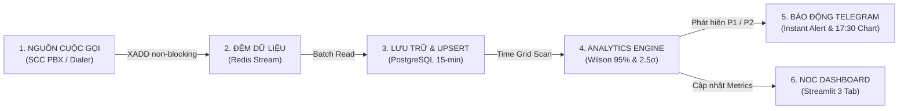

# 📞 SCC Outbound: Real-Time Time-Series Pipeline & Anomaly Detection

[](https://www.python.org/)
[](https://www.docker.com/)
[](https://www.postgresql.org/)
[](https://streamlit.io/)
[](https://redis.io/)
[](LICENSE)

> **Hệ thống giám sát thời gian thực, tổng hợp chuỗi thời gian (Time-series Pipeline) và phát hiện bất thường đa tầng cho các cuộc gọi đi (Outbound Calls) từ trung tâm liên lạc SCC Contact Center.**

---

## 🔄 Luồng Hoạt Động Của Hệ Thống (Workflow & Data Pipeline)

Hệ thống vận hành theo quy trình khép kín qua 4 giai đoạn liên tục:



1. **Thu thập CDR thời gian thực:** Cuộc gọi phát sinh từ tổng đài SCC được bắn tức thì vào **Redis Stream** (`scc_call_stream`) qua cơ chế non-blocking, giải phóng I/O và không làm nghẽn tổng đài.
2. **Ghi nhận & Tổng hợp chuỗi thời gian:** `db_writer.py` đọc batch nạp vào bảng thô `calls_stream`. Định kỳ 15 phút, câu lệnh SQL thực hiện **Idempotent UPSERT** sang bảng `call_timeseries` kết hợp **Zero-imputation** bằng `generate_series()` để đảm bảo lưới thời gian liên tục 100%, không bị thủng lỗ khung rỗng.
3. **Phân tích & Quét ngưỡng bất thường:** Engine `daily_reporter.py` quét dữ liệu mỗi chu kỳ:
   - *Bộ lọc rỗng:* $V = 0$ trong giờ làm việc ($\mu_h \ge 2.5$) $\rightarrow$ Phát hiện **🔴 P1 Sập PBX**.
   - *Ngưỡng động & Sàn Bayes:* Tính ngưỡng động **Wilson Score Interval 95%** ($z=1.96$) kết hợp **sàn lọc mẫu từ tiên nghiệm Bayes** ($N \ge 4$ và $\text{Lỗi}_{503} \ge 2$) $\rightarrow$ Triệt tiêu báo động giả ở cỡ mẫu nhỏ, phát hiện **🔴 P1 Lỗi SIP Trunk**.
   - *Thể tích động:* So sánh thể tích $V$ với dải lịch sử chu kỳ 24h $\mu_h \pm 2.5\sigma_h$ (hoặc $Z \ge 2.0$) $\rightarrow$ Phát hiện **🟡 P2 Đột Biến Tải**.
4. **Cảnh báo tức thời & Trực quan hóa:**
   - Kích hoạt **Telegram Bot** gửi thông báo khẩn cấp (HTML + SOP xử lý) và tự động xuất biểu đồ tổng kết ngày lúc **17:30**.
   - Đồng bộ trạng thái lên **Streamlit NOC Dashboard** phục vụ trực ban theo dõi trực quan 24/7.

---

## 🧩 Các Thành Phần Hệ Thống (System Components)

| Thành phần | Module / Dịch vụ | Vai trò & Chức năng chi tiết |
| :--- | :--- | :--- |
| **Event Generator** | `producer.py` | Giả lập luồng cuộc gọi CDR thực tế theo 38 khung giờ làm việc; mô phỏng các kịch bản sự cố viễn thông (P1 Sập PBX, P1 Nghẽn Trunk 503, P2 Đột biến tải). |
| **Message Broker** | `stream_engine.py` / `scc_redis` | Đệm sự kiện qua Redis Stream (`scc_call_stream`), hỗ trợ cơ chế Consumer Group đảm bảo không thất thoát dữ liệu khi lưu lượng tăng đột biến. |
| **Storage & Ingestion** | `db_writer.py` / `scc_postgres` | Ghi dữ liệu thô vào `calls_stream` (Partitioning theo tháng) và tự động UPSERT dữ liệu chuỗi thời gian 15-phút vào `call_timeseries`. |
| **Baseline Calibration** | `ml_baseline_trainer.py` | Phân tích chu kỳ ngày 24h theo từng giờ từ dữ liệu lịch sử, áp dụng mô hình Isolation Forest lọc dữ liệu ngoại lai và xuất hồ sơ chuẩn `baseline_profile.json`. |
| **Analytics Engine** | `daily_reporter.py` | Trái tim toán học: Quét ngưỡng động Wilson Score 95% ($z=1.96$), áp dụng sàn lọc mẫu Bayes ($N \ge 4, \text{lỗi} \ge 2$) và dải phân phối thể tích động 2.5$\sigma$. |
| **Profile & Calibration** | `baseline_profile.json` | Lưu trữ hồ sơ dải kỳ vọng 24 giờ ($\mu_h, \sigma_h$, Upper/Lower Limits) và tham số tiên nghiệm Bayes ($p_0=0.02, \text{sàn mẫu } N \ge 4, \text{lỗi} \ge 2$). |
| **NOC Dashboard** | `dashboard_monitor.py` | Giao diện Web Streamlit 3 Tab (Tab 1: Giám sát trực tiếp; Tab 2: Phân tích xu hướng chu kỳ 24h; Tab 3: Báo cáo đối soát đa ngày). |
| **Alerting Bot** | `telegram_notifier.py` | Kênh thông báo tức thời 24/7 qua Telegram Webhook; tự động xuất biểu đồ phân tích 3 phần gửi lúc 17:30 kèm cơ chế chống gửi lặp `exported_reports.json`. |

---

## 📚 Thư Viện & Công Nghệ Sử Dụng (Tech Stack & Libraries)

Các thư viện được khóa phiên bản chính xác trong [`requirements.txt`](requirements.txt) nhằm đảm bảo tính tái lập (reproducible builds) trên môi trường Production:

| Thư viện | Phiên bản | Nhóm chức năng | Vai trò trong hệ thống |
| :--- | :---: | :--- | :--- |
| **Streamlit** | `1.32.2` | Frontend / UI | Xây dựng Dashboard giám sát trực ban NOC, hỗ trợ Dark/Light mode, tự động làm mới dữ liệu. |
| **Pandas** | `2.2.1` | Data Processing | Xử lý dữ liệu dạng bảng, gom nhóm khung thời gian (resampling 15-min), merge lưới thời gian và tính toán thống kê. |
| **NumPy** | `1.26.4` | Mathematics | Thực thi các phép tính ma trận, giải phương trình căn bậc hai Wilson Score, kẹp dải (clipping) và tính Z-score. |
| **Scikit-learn** | `1.4.1.post1` | Machine Learning | Huấn luyện mô hình Isolation Forest trong `ml_baseline_trainer.py` để lọc dữ liệu ngoại lai lịch sử. |
| **Redis** | `5.0.3` | Message Broker | Client giao tiếp với Redis Stream (`xadd`, `xreadgroup`, `xack`), xử lý sự kiện bất đồng bộ. |
| **Psycopg2-binary** | `2.9.9` | Database Driver | Driver kết nối tầng thấp tới PostgreSQL, hỗ trợ nạp dữ liệu hàng loạt (`execute_batch`) hiệu năng cao. |
| **SQLAlchemy** | `2.0.28` | ORM / DB Engine | Quản lý Connection Pool và thực thi truy vấn phân tích tổng hợp dữ liệu thời gian thực. |
| **Plotly** | `5.24.1` | Visualization | Vẽ biểu đồ tương tác trên Streamlit (hỗ trợ hover chi tiết từng điểm dữ liệu, dải mây baseline). |
| **Matplotlib** | `3.8.3` | Chart Export | Vẽ biểu đồ tổng kết ngày chuẩn 3 phần (Summary Box, Volume, Error 503) để xuất file PNG gửi Telegram. |
| **Requests** | `2.31.0` | HTTP Client | Gửi webhook cảnh báo và truyền tải file ảnh tới Telegram Bot API qua HTTP Proxy. |
| **Pillow** | `10.2.0` | Image Processing | Xử lý định dạng và tối ưu dung lượng ảnh biểu đồ trước khi truyền qua mạng viễn thông. |
| **Python-dateutil** | `2.9.0.post0` | Date Utilities | Xử lý múi giờ, định dạng chuỗi thời gian viễn thông và bước nhảy lịch làm việc. |

---

## 📐 Quy Tắc Đo Ngưỡng & Ma Trận Sự Cố (Severity Matrix)

| Cấp độ | Tên sự cố | Điều kiện kích hoạt | Nguyên nhân cốt lõi | Hành động trực ban (SOP) |
| :---: | :--- | :--- | :--- | :--- |
| **🔴 P1** | **Sập Lưu Lượng PBX** | $calls\_total = 0$ VÀ $\mu_h \ge 2.5$ | Tổng đài sập nguồn, kẹt hàng đợi quay số, đứt cáp truyền dẫn. | 1. Kiểm tra container tổng đài PBX.<br>2. Khởi động lại tiến trình auto-dialer.<br>3. Kiểm tra kết nối mạng nội bộ. |
| **🔴 P1** | **Lỗi Hạ Tầng SIP Trunk** | $\text{ErrorRate} \ge \text{Wilson Threshold}_{95\%}$<br>VÀ $N \ge 4$ VÀ $\text{Lỗi}_{503} \ge 2$ | Nhà mạng viễn thông từ chối kết nối SIP 503, quá tải Gateway. | 1. Xác định nhà mạng bị sự cố.<br>2. Chuyển hướng sang Trunk dự phòng (Failover).<br>3. Báo sự cố khẩn cấp cho nhà mạng. |
| **🟡 P2** | **Đột Biến Tải Chiến Dịch** | $N \ge \text{Upper Limit}$ HOẶC<br>($Z \ge 2.0$ VÀ $N \ge 7$) HOẶC $N \ge 9$ | Chiến dịch Telesales xả cuộc gọi ồ ạt, dialer bị lặp vòng vô hạn. | 1. Yêu cầu Telesales giảm tốc độ quay số (pacing rate).<br>2. Giám sát tải CPU/RAM máy chủ PBX. |
| **🟢 Normal** | **Bình Thường** | Các chỉ số nằm trong dải an toàn | Hệ thống vận hành ổn định trong tầm kiểm soát. | Tiếp tục duy trì giám sát tự động. |

---

## 📁 Cấu Trúc Thư Mục Dự Án (Project Structure)

```text
scc-outbound-timeseries/
├── docker-compose.yml              # Cụm container: PostgreSQL 16, Redis 7.2, Dashboard, Producer
├── Dockerfile                      # Image build Python 3.11-slim
├── requirements.txt                # Thư viện phụ thuộc khóa phiên bản chính xác
├── .env.example                    # Mẫu biến môi trường an toàn (DB, Telegram, Ports)
├── .gitignore                      # Loại trừ file bí mật và file sinh tự động
├── timeseries.sql                  # Script SQL tạo bảng chuỗi 15-phút, UPSERT & Zero-filling
├── export_call_timeseries.sql      # Script trích xuất và đối soát dữ liệu chuỗi thời gian
│
├── anomaly_detection_python/       # Module cốt lõi phân tích bất thường & Pipeline
│   ├── baseline_profile.json       # Hồ sơ ngưỡng động 24h & tham số Bayesian
│   ├── ml_baseline_trainer.py      # Huấn luyện baseline & lọc ngoại lai (Isolation Forest)
│   ├── producer.py                 # Giả lập sinh luồng cuộc gọi kèm kịch bản sự cố
│   ├── db_writer.py                # Consumer đọc Redis Stream nạp vào PostgreSQL
│   ├── stream_engine.py            # Client kết nối Redis Stream non-blocking
│   ├── daily_reporter.py           # Thuật toán Wilson Score 95%, Bayes & xuất biểu đồ
│   ├── dashboard_monitor.py        # Streamlit Web Dashboard 3 Tab giám sát NOC
│   ├── telegram_notifier.py        # Module gửi tin nhắn & ảnh báo cáo qua Telegram API
│   └── data/                       # Dữ liệu đệm và lưu vết báo cáo đã gửi
│       ├── call_timeseries.csv
│       ├── seed_historical_stream.csv
│       ├── stream_buffer.csv
│       └── exported_reports.json
│
└── data/                           # Dữ liệu lịch sử phục vụ baseline & đối soát
    ├── outbound_calls_timeseries_hourly_may.csv
    ├── outbound_calls_timeseries_daily_full.csv
    └── calls_raw.csv
```

---

## 🚀 Hướng Dẫn Cài Đặt & Vận Hành Nhanh (Quick Start)

### 1. Khởi Động Toàn Bộ Bằng Docker Compose
```bash
# 1. Clone mã nguồn
git clone https://github.com/MinhTran110/scc-anomaly-detection.git
cd scc-anomaly-detection

# 2. Khởi tạo file môi trường
cp .env.example .env

# 3. Khởi chạy toàn bộ cụm dịch vụ
docker compose up -d
```

Truy cập các dịch vụ:
- **Streamlit NOC Dashboard:** `http://localhost:8501`
- **PostgreSQL Database:** `localhost:5433` (hoặc `5432`)
- **Redis Message Broker:** `localhost:6379` (hoặc `6380`)

### 2. Cập Nhật / Huấn Luyện Hồ Sơ Baseline
```bash
python3 anomaly_detection_python/ml_baseline_trainer.py
# Kết quả: Cập nhật baseline_profile.json dựa trên dữ liệu lịch sử và mô hình Isolation Forest
```

### 3. Chạy Giả Lập Sinh Dữ Liệu Sự Cố (Producer)
```bash
docker exec -it scc_dashboard python3 anomaly_detection_python/producer.py
```

### 4. Xuất Báo Cáo Ngày Thủ Công (Daily Reporter)
```bash
docker exec -it scc_dashboard python3 anomaly_detection_python/daily_reporter.py --date 2026-05-18
```

---

## 👤 Tác Giả & Bản Quyền

- **Tác giả:** [MinhTran110](https://github.com/MinhTran110)
- **Dự án:** SCC Outbound Time-Series Pipeline & Real-Time Anomaly Detection
- **Giấy phép:** [MIT License](LICENSE)

