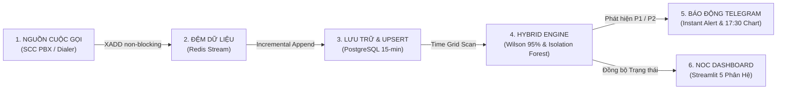

# 📞 SCC Outbound: Real-Time Time-Series Pipeline & Anomaly Detection

[](https://www.python.org/)
[](https://www.docker.com/)
[](https://www.postgresql.org/)
[](https://streamlit.io/)
[](https://redis.io/)
[](https://scikit-learn.org/)
[](LICENSE)

> **Hệ thống giám sát vận hành thời gian thực (Production NOC), tổng hợp chuỗi thời gian 15 phút (Time-Series Pipeline) và phát hiện bất thường đa tầng (Multivariate Anomaly Detection) cho trung tâm liên lạc SCC Outbound Contact Center.**

---

## 🔄 Luồng Hoạt Động Của Hệ Thống (Workflow & Data Pipeline)

Hệ thống vận hành theo quy trình khép kín qua 6 giai đoạn liên tục:



1. **Thu thập CDR thời gian thực:** Cuộc gọi phát sinh từ tổng đài SCC được đẩy tức thì vào **Redis Stream** (`scc_call_stream`) qua cơ chế non-blocking, giải phóng I/O và không làm nghẽn tổng đài.
2. **Ghi nhận & Tổng hợp chuỗi thời gian:** `db_writer.py` nạp dữ liệu thô vào `calls_stream` và lưu đệm tại `stream_buffer.csv` theo cơ chế ghi vi sai (`mode="a"`). Định kỳ 15 phút, thủ tục PL/pgSQL thực hiện **Incremental UPSERT** sang bảng `call_timeseries` kết hợp **Zero-imputation** bằng `generate_series()` để đảm bảo lưới thời gian liên tục 100% (38 khung/ngày, từ 08:00 đến 17:30), không bị đứt đoạn.
3. **Phát hiện bất thường đa tầng (Hybrid Analytics Engine):**
   - *Bộ lọc rỗng:* Thể tích `V = 0` trong giờ làm việc (`μ_h >= 2.5`) ➔ Phát hiện **🔴 P1 Sập PBX (Drop Traffic)**.
   - *Ngưỡng động Wilson 95% & Sàn Bayes:* Tự động co giãn theo cỡ mẫu `N` với `z = 1.96` kết hợp sàn mẫu (`N >= 4` và `Lỗi >= 2`) ➔ Triệt tiêu 100% báo động giả ở cỡ mẫu nhỏ, phát hiện **🔴 P1 Nghẽn Mạng SIP Trunk (503 / 504 / 500 / 429)**.
   - *Thể tích động:* So sánh thể tích `V` với dải lịch sử chu kỳ 24h `μ_h ± 2.5σ_h` (hoặc `Z >= 2.5`) ➔ Phát hiện **🟡 P2 Đột Biến Tải Chiến Dịch (Traffic Spike)**.
   - *Mô hình học máy không giám sát:* **Isolation Forest** kiểm tra vector 10 chiều (lưu lượng, tỷ lệ lỗi, thời lượng đàm thoại, độ trễ, mã hóa lượng giác 24h) để phát hiện dị biệt phức tạp (bot kẹt, suy giảm chất lượng).
4. **Cảnh báo tức thời & Trực quan hóa vận hành:**
   - Kích hoạt **Telegram Bot** gửi thông báo khẩn cấp (HTML + mã lỗi + SOP xử lý) và tự động xuất biểu đồ tổng kết ngày lúc **17:30**.
   - Đồng bộ trạng thái lên **NOC Dashboard** gồm 5 phân hệ chuyên trách phục vụ trực ban 24/7.

---

## 🖥️ Các Phân Hệ Trên NOC Dashboard (Version 3.2.2)

Sidebar của hệ thống được tổ chức thành **5 phân hệ chuyên biệt**:

| Phân hệ (Tab) | Vai trò & Tính năng chính |
| :--- | :--- |
| **`Live Operations`** | **Giám sát thời gian thực:** Banner trạng thái hệ thống (`HEALTHY`, `WARNING`, `DEGRADED`), Hàng đợi sự cố cần xử lý (Incident Queue), 2 biểu đồ Plotly song song (Lưu lượng vs Vùng an toàn 2.5σ và Tỷ lệ lỗi vs Ngưỡng động Wilson 95%), Nhật ký vận hành trong ngày, Bộ lọc lịch kèm nút tắt `⚡ Hôm nay` và `⏮️ Hôm qua`. |
| **`Incidents`** | **Điều tra & Quản lý sự cố:** Bộ lọc đa chiều (Mức độ P1/P2, Tuyến nhà mạng, Trạng thái), Hồ sơ điều tra kỹ thuật 2 khối (`What happened` & `How to fix — SOP`), Tra cứu bằng chứng và nhật ký cuộc gọi thô (`Evidence & call logs`), Các nút tác vụ trực ban (`Acknowledge`, `Mark mitigated`, `Incident note`). |
| **`Analytics`** | **Phân tích chu kỳ & Thống kê sâu:** Phân rã chu kỳ 24h (Diurnal Seasonality), Ma trận nhiệt rủi ro theo từng giờ (Hourly Risk Heatmap), Đánh giá nguy cơ sự cố theo khung giờ cao điểm. |
| **`Reports`** | **Báo cáo tổng hợp & Đối soát:** Bộ lọc tuần làm việc tự động (Thứ 2 – Thứ 6), Nút `📊 Tổng Hợp Toàn Bộ` dải ngày lịch sử, Thẻ điểm đối soát nhà mạng (Carrier Scorecard: Viettel, VNPT, MobiFone), Xuất báo cáo PDF/PNG. |
| **`System Health`** | **Đo lường hạ tầng kỹ thuật:** Giám sát trạng thái ghi song song 2 Database PostgreSQL (Dual-Write Telemetry), Bộ đệm Redis Stream 6380, và Kết nối Telegram Webhook qua Squid Proxy. |

---

## 🤖 Đối Chuẩn Mô Hình Học Máy (ML Benchmark Matrix)

Hệ thống đã huấn luyện và đối chuẩn độc lập 5 mô hình trên tập kiểm thử **30% Test (Temporal Split)** không rò rỉ dữ liệu tương lai (kết quả lưu tại [`models/benchmark_report.json`](anomaly_detection_python/models/benchmark_report.json)):

| Mô Hình (Model) | Thuật toán | AUC-ROC | PR-AUC | Precision | Recall | F1-Score | Báo động giả (FPR) | Độ trễ suy luận |
| :--- | :--- | :---: | :---: | :---: | :---: | :---: | :---: | :---: |
| **Isolation Forest** | Core Tree ML (150 trees) | **0.9904** | **0.9100** | **96.4%** | 42.2% | 0.587 | **0.15%** | **0.02 ms** |
| **Statistical Rule Engine** | Wilson Score 95% + 2.5σ | 0.8342 | 0.8438 | **100.0%** | **82.8%** | **0.906** | **0.00%** | **0.07 ms** |
| **One-Class SVM** | RBF Kernel + RobustScaler | 0.8039 | 0.6080 | 100.0% | 31.3% | 0.476 | 0.00% | 0.01 ms |
| **Local Outlier Factor** | LOF Density (k = 25) | 0.4573 | 0.1175 | 15.8% | 4.7% | 0.072 | 2.45% | 0.04 ms |

> **Cơ chế triển khai thực tế (Hybrid Ensemble):** Kết hợp rào chắn **Statistical Rule Engine** (Precision 100%, triệt tiêu hoàn toàn báo động giả ở cỡ mẫu nhỏ) cùng **Isolation Forest** (nhận diện các tương quan đa biến phức tạp giữa thời lượng đàm thoại, chu kỳ giờ và tỷ lệ rớt cuộc gọi).

---

## 🧩 Các Thành Phần Hệ Thống (System Components)

| Thành phần | File / Module | Chức năng chi tiết |
| :--- | :--- | :--- |
| **Event Generator** | `producer.py` | Giả lập luồng cuộc gọi CDR theo 38 khung giờ làm việc; cơ chế **ghi vi sai (`mode="a"`)** tránh phình RAM/I/O; tự động bỏ qua backfill khi DB đã có dữ liệu. |
| **Message Broker** | `stream_engine.py` / `scc_redis` | Đệm sự kiện qua Redis Stream (`scc_call_stream`) cổng 6380, hỗ trợ fallback sang thread-safe in-memory ring buffer khi mất kết nối. |
| **Storage & Ingestion** | `db_writer.py` / `scc_postgres` | Ghi song song 2 Database (Dual-Write), đồng bộ dữ liệu vào `calls_stream` và kích hoạt tổng hợp `call_timeseries`. |
| **Relational & Time-Series DB**| `timeseries.sql` | Script DDL 8 bảng chuẩn ERD, danh mục 13 mã trạng thái `call_results`, Seed Data quan hệ, và thủ tục PL/pgSQL Incremental Upsert vi sai 15 phút. |
| **ML Training Pipeline** | `ml_train_pipeline.py` | Trích xuất 10 đặc trưng chuỗi thời gian, chuẩn hóa RobustScaler, huấn luyện đối đầu 5 mô hình và xuất báo cáo đối chuẩn benchmark. |
| **Real-time Inference** | `ml_inference_engine.py` | Lớp suy luận thời gian thực (< 2ms) nạp mô hình `isolation_forest.joblib` để chấm điểm và phân cấp sự cố. |
| **Baseline Calibration** | `ml_baseline_trainer.py` | Phân rã chu kỳ ngày/đêm 24h theo từng khung giờ từ dữ liệu lịch sử và xuất file cấu hình `baseline_profile.json`. |
| **Analytics Engine** | `daily_reporter.py` | Tính toán ngưỡng động Wilson Score 95% (`z = 1.96`), sàn lọc mẫu Bayes (`N >= 4, lỗi >= 2`), dải thể tích `2.5σ`, và vẽ biểu đồ tổng kết ngày. |
| **NOC Dashboard** | `dashboard_monitor.py` | Giao diện Streamlit v3.2.2 gồm 5 phân hệ, tối ưu Dark/Light Mode, Native Auto-refresh 10s/lần với bộ nhớ đệm RAM chống quá tải CPU. |
| **Alerting Bot** | `telegram_notifier.py` | Gửi cảnh báo P1/P2 tức thời và ảnh báo cáo ngày qua Telegram Webhook (hỗ trợ Squid Proxy). |

---

## 📚 Thư Viện & Công Nghệ Sử Dụng (Tech Stack)

Các thư viện được khóa phiên bản chính xác trong [`requirements.txt`](requirements.txt):

| Thư viện | Phiên bản | Nhóm chức năng | Vai trò trong hệ thống |
| :--- | :---: | :--- | :--- |
| **Streamlit** | `1.32.2` | Frontend / UI | Xây dựng NOC Dashboard, hỗ trợ chuyển theme Sáng / Tối linh hoạt. |
| **streamlit-autorefresh** | `1.0.1` | UI Performance | Tự động làm mới dữ liệu 10s/lần không gây giật lag hoặc mất focus của người dùng. |
| **Pandas** | `2.2.1` | Data Processing | Xử lý dữ liệu bảng, phân đoạn chuỗi thời gian 15 phút, tính toán thống kê. |
| **NumPy** | `1.26.4` | Mathematics | Tính toán ma trận, phương trình căn bậc hai Wilson Score, độ lệch chuẩn. |
| **Scikit-learn** | `1.4.1.post1` | Machine Learning | Huấn luyện mô hình Isolation Forest, One-Class SVM, LOF và bộ chuẩn hóa RobustScaler. |
| **Joblib** | `1.3.2` | Model Persistence | Đóng gói và nạp các mô hình nhị phân `.joblib` phục vụ suy luận thời gian thực. |
| **Redis** | `5.0.3` | Message Broker | Client giao tiếp Redis Stream (`xadd`, `xreadgroup`, `xack`). |
| **Psycopg2-binary** | `2.9.9` | Database Driver | Driver kết nối PostgreSQL, hỗ trợ nạp dữ liệu vi sai tốc độ cao. |
| **SQLAlchemy** | `2.0.28` | ORM Engine | Quản lý kết nối và thực thi câu lệnh SQL phân tích. |
| **Plotly** | `5.24.1` | Visualization | Biểu đồ tương tác thời gian thực, dải tin cậy và điểm sự cố trên Dashboard. |
| **Matplotlib** | `3.8.3` | Chart Export | Xuất biểu đồ 3 phần tổng kết ngày gửi qua Telegram lúc 17:30. |
| **Requests** | `2.31.0` | HTTP Client | Gửi webhook cảnh báo và ảnh báo cáo tới Telegram Bot API qua Proxy. |
| **Pillow** | `10.2.0` | Image Processing | Tối ưu dung lượng ảnh biểu đồ trước khi truyền qua mạng. |
| **Python-dateutil** | `2.9.0.post0` | Date Utilities | Xử lý múi giờ, định dạng ngày làm việc và bước nhảy thời gian. |

---

## 📐 Quy Tắc Đo Ngưỡng & Ma Trận Sự Cố (Severity Matrix)

| Cấp độ | Tên sự cố | Điều kiện kích hoạt | Nguyên nhân cốt lõi | Hành động trực ban (SOP) |
| :---: | :--- | :--- | :--- | :--- |
| **🔴 P1** | **Sập Lưu Lượng PBX** | `calls_total <= 15`<br>VÀ `μ_h >= 50` *(Giờ hành chính)* | Tổng đài sập nguồn, kẹt hàng đợi quay số, mất kết nối mạng. | 1. Kiểm tra container tổng đài Asterisk PBX.<br>2. Khởi động lại tiến trình auto-dialer.<br>3. Kiểm tra kết nối mạng nội bộ và database hàng đợi. |
| **🔴 P1** | **Lỗi Hạ Tầng SIP Trunk** | `ErrorRate >= Ngưỡng Wilson 95%`<br>VÀ `N >= 4` VÀ `calls_failed >= 2` | Tuyến SIP Trunk nhà mạng quá tải, từ chối kết nối (503 / 504 / 500 / 429). | 1. Định vị nhà mạng lỗi (Viettel / VNPT / MobiFone).<br>2. Chuyển tuyến cuộc gọi dự phòng (LCR Failover).<br>3. Liên hệ hotline NOC nhà mạng đối tác. |
| **🟡 P2** | **Đột Biến Tải Chiến Dịch** | `N >= Upper Limit`<br>HOẶC (`Z >= 2.5` VÀ `N >= 20`) | Chiến dịch Telesale xả cuộc gọi ồ ạt, nguy cơ nghẽn kênh tổng đài. | 1. Yêu cầu bộ phận vận hành giảm tốc độ quay số (CPS).<br>2. Phân bổ chiến dịch ra nhiều dải đầu số (CLI).<br>3. Giám sát tải CPU/RAM máy chủ. |
| **🟢 Normal** | **Vận Hành Ổn Định** | Tất cả chỉ số nằm trong dải an toàn | Hệ thống hoạt động bình thường theo đúng chu kỳ sinh học ngày/tuần. | Tiếp tục duy trì giám sát tự động. |

---

## 📁 Cấu Trúc Thư Mục Dự Án (Project Structure)

```text
scc-outbound-timeseries/
├── docker-compose.yml              # Cụm container: PostgreSQL 16, Redis 7.2, Dashboard, Producer
├── Dockerfile                      # Image build Python 3.11-slim
├── requirements.txt                # Thư viện phụ thuộc khóa phiên bản chính xác
├── .env.example                    # Mẫu biến môi trường an toàn (DB, Telegram, Proxy)
├── .gitignore                      # Loại trừ file tạm, cache và dữ liệu nhạy cảm
├── timeseries.sql                  # DDL 8 bảng chuẩn ERD, Seed Data, UPSERT & Zero-filling
│
├── anomaly_detection_python/       # Module cốt lõi phân tích bất thường & Pipeline
│   ├── baseline_profile.json       # Hồ sơ ngưỡng động 24h & tham số Bayesian
│   ├── ml_train_pipeline.py        # Pipeline huấn luyện & benchmark đối đầu 5 mô hình ML
│   ├── ml_inference_engine.py      # Lớp suy luận bất thường thời gian thực (< 2ms)
│   ├── ml_baseline_trainer.py      # Phân rã chu kỳ ngày 24h từ dữ liệu lịch sử
│   ├── producer.py                 # Giả lập sinh cuộc gọi vi sai (Incremental Append)
│   ├── db_writer.py                # Dual-Write Consumer nạp dữ liệu vào PostgreSQL
│   ├── stream_engine.py            # Client kết nối Redis Stream non-blocking
│   ├── daily_reporter.py           # Thuật toán Wilson Score 95%, Bayes & xuất biểu đồ
│   ├── dashboard_monitor.py        # Streamlit NOC Dashboard v3.2.2 (5 phân hệ)
│   ├── telegram_notifier.py        # Gửi cảnh báo & biểu đồ báo cáo qua Telegram API
│   │
│   ├── models/                     # Thư mục lưu trữ artifact mô hình Machine Learning
│   │   ├── isolation_forest.joblib # Mô hình Isolation Forest đã huấn luyện
│   │   ├── oc_svm.joblib           # Mô hình One-Class SVM đối chuẩn
│   │   ├── lof.joblib              # Mô hình Local Outlier Factor đối chuẩn
│   │   ├── scaler.joblib           # Bộ chuẩn hóa RobustScaler
│   │   ├── benchmark_report.json   # Kết quả đo lường toàn diện (AUC-ROC, F1, Latency)
│   │   └── top_anomalies_ranking.json # Xếp hạng các sự cố nghiêm trọng nhất
│   │
│   └── data/                       # Dữ liệu đệm và lưu vết báo cáo đã gửi
│       ├── call_timeseries.csv     # Chuỗi thời gian 15 phút tổng hợp
│       ├── seed_historical_stream.csv # Dữ liệu mồi dòng cuộc gọi lịch sử
│       ├── stream_buffer.csv       # Buffer dòng cuộc gọi đang chạy
│       └── exported_reports.json   # Trạng thái báo cáo ngày đã gửi Telegram
│
└── data/                           # Dữ liệu đối soát lịch sử
    ├── outbound_calls_timeseries_hourly_may.csv
    ├── outbound_calls_timeseries_daily_full.csv
    └── calls_raw.csv
```

---

## 🚀 Hướng Dẫn Cài Đặt & Vận Hành Nhanh (Quick Start)

### 1. Khởi Động Toàn Bộ Bằng Docker Compose (Khuyên Dùng)
```bash
# 1. Clone mã nguồn
git clone https://github.com/MinhTran110/scc-anomaly-detection.git
cd scc-anomaly-detection

# 2. Khởi tạo file môi trường
cp .env.example .env

# 3. Khởi chạy toàn bộ cụm dịch vụ chạy ngầm
docker compose up -d
```

Truy cập các dịch vụ:
- **Streamlit NOC Dashboard:** `http://localhost:8501` (hoặc `http://<IP_MÁY_CHỦ>:8501`)
- **PostgreSQL Database:** `localhost:5433` (hoặc `5432`)
- **Redis Message Broker:** `localhost:6380` (hoặc `6379`)

### 2. Huấn Luyện & Đối Chuẩn Mô Hình Machine Learning
```bash
# Huấn luyện mô hình Isolation Forest và xuất hồ sơ benchmark
python3 anomaly_detection_python/ml_train_pipeline.py
```

### 3. Cập Nhật Hồ Sơ Chu Kỳ Baseline 24h
```bash
python3 anomaly_detection_python/ml_baseline_trainer.py
```

### 4. Xuất Báo Cáo Ngày Thủ Công (Daily Reporter)
```bash
docker exec -it scc_dashboard python3 anomaly_detection_python/daily_reporter.py --date 2026-11-24
```

---

## 👤 Tác Giả & Bản Quyền

- **Tác giả:** [MinhTran110](https://github.com/MinhTran110)
- **Dự án:** SCC Outbound Time-Series Pipeline & Real-Time Anomaly Detection
- **Phiên bản:** `v3.2.2` (Production NOC Release)
- **Giấy phép:** [MIT License](LICENSE)
