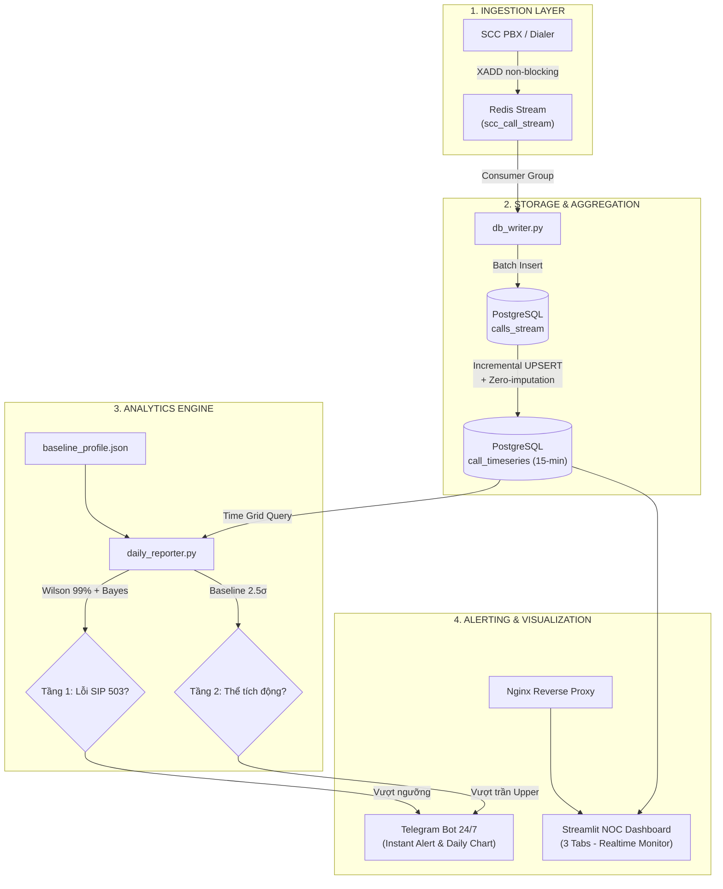

# 📞 SCC Outbound: Real-Time Time-Series Pipeline & Anomaly Detection

[](https://www.python.org/)
[](https://www.docker.com/)
[](https://www.postgresql.org/)
[](https://streamlit.io/)
[](https://redis.io/)
[]()

> **Hệ thống giám sát thời gian thực, tổng hợp chuỗi thời gian (Time-series Pipeline) và phát hiện bất thường đa tầng cho các cuộc gọi đi (Outbound Calls) từ trung tâm liên lạc SCC Contact Center.**

---

## 🌟 Điểm Nổi Bật Của Hệ Thống (Key Features)

- **⚡ Pipeline Chuỗi Thời Gian Tự Động:**
  - Thu thập bản ghi CDR (Call Detail Records) từ tổng đài SCC qua **Redis Stream** (`XADD` non-blocking).
  - Tự động gom nhóm chuỗi thời gian theo khung cố định **15 phút** (và cửa sổ trượt 5 phút thời gian thực).
  - **Zero-imputation:** Điền khuyết dữ liệu liên tục bằng `generate_series()`, không làm thủng lỗ chuỗi thời gian khi có khung giờ rỗng.
  - **Idempotent UPSERT:** Chống trùng lặp dữ liệu khi nạp lại hoặc nhận dữ liệu trễ (`ON CONFLICT (bucket_time) DO UPDATE`).

- **🧠 Thuật Toán Phát Hiện Bất Thường Đa Tầng (Multi-Tier Anomaly Detection):**
  - **Bộ lọc rỗng (Zero-traffic Floor):** Phát hiện tức thời sự cố sập tổng đài hoặc kẹt hàng đợi (`calls_total == 0` khi $\mu \ge 2.5$) $\rightarrow$ Cảnh báo **🔴 P1 Drop PBX**.
  - **Sàn bảo vệ mẫu (Sample Guardrail):** Chỉ kích hoạt kiểm định tỉ lệ khi $N \ge 4$ và Lỗi $\ge 2$, loại bỏ triệt để hiện tượng báo động giả khi mở ca/đêm.
  - **Tầng 1 - Wilson Score Interval 99%:** Ước lượng cận trên tỉ lệ lỗi mạng SIP 503 với mức ý nghĩa $99\%$, kết hợp làm mịn tiên nghiệm Bayes $\text{Beta}(\alpha=0.4, \beta=19.6)$ $\rightarrow$ Cảnh báo **🔴 P1 Lỗi SIP Trunk**.
  - **Tầng 2 - Thể tích động 2.5-Sigma:** Nhận diện tính chu kỳ sinh học ngày 24h (**Diurnal Seasonality**), dải biên $\mu_h \pm 2.5\sigma_h$ $\rightarrow$ Cảnh báo **🟡 P2 Đột Biến Tải (Traffic Spike)**.

- **📊 NOC Monitoring Dashboard (Streamlit 3 Tab):**
  - **Tab 1 - Giám Sát Trực Tiếp:** Biểu đồ chuỗi thời gian song song (Lưu lượng vs Upper Limit, Tỉ lệ lỗi 503 vs Ngưỡng Wilson động) và bảng sự cố vận hành kèm khuyến nghị xử lý.
  - **Tab 2 - Phân Tích Xu Hướng:** Phân rã chu kỳ 24h và ma trận dự báo nguy cơ bất thường theo từng khung giờ.
  - **Tab 3 - Báo Cáo Đa Ngày:** Thống kê lịch sử vận hành, tổng hợp KPI (ASR, NER, Volume) và đối soát SLA viễn thông.
  - Hỗ trợ cả giao diện **Sáng ☀️ / Tối 🌙**, phím tắt nhanh chuyển tab (phím `1`, `2`, `3`), tốc độ tải trang cực nhanh (< 0.5s).

- **🔔 Kênh Cảnh Báo & Báo Cáo Tự Động Telegram Bot:**
  - Bắn tin nhắn cảnh báo khẩn cấp định dạng HTML tức thời khi phát hiện P1/P2 kèm hướng dẫn SOP.
  - Đúng **17:30** hàng ngày, tự động vẽ biểu đồ phân tích 3 phần và gửi báo cáo tổng kết ngày vào nhóm Telegram trực ban.
  - Tích hợp tệp ghi nhớ `exported_reports.json` chống gửi trùng lặp.

---

## 🏛️ Kiến Trúc Hệ Thống (Architecture)



---

## 📐 Bảng Ma Trận Phân Cấp Sự Cố (Severity Matrix)

| Cấp độ | Tên sự cố | Điều kiện logic kích hoạt | Nguyên nhân cốt lõi | Quy trình ứng cứu trực ban (SOP) |
| :---: | :--- | :--- | :--- | :--- |
| **🔴 P1** | **Sập Lưu Lượng PBX** | $calls\_total = 0$ VÀ $\mu_h \ge 2.5$ | Tổng đài sập nguồn, tiến trình quay số (dialer) bị treo, đứt cáp mạng. | 1. Kiểm tra container tổng đài Asterisk/FreePBX.<br>2. Khởi động lại dịch vụ auto-dialer.<br>3. Kiểm tra kết nối mạng nội bộ. |
| **🔴 P1** | **Lỗi Hạ Tầng SIP Trunk** | $\text{ErrorRate} \ge \text{Wilson Threshold}$<br>VÀ $N \ge 4$ VÀ $\text{Lỗi}_{503} \ge 2$ | Nhà mạng viễn thông từ chối cuộc gọi, nghẽn trung kế SIP 503, quá tải Gateway. | 1. Xác định nhà mạng bị sự cố (VNPT/Viettel/Mobi).<br>2. Chuyển hướng lưu lượng sang SIP Trunk dự phòng (Failover).<br>3. Gửi ticket khẩn cấp cho nhà mạng. |
| **🟡 P2** | **Đột Biến Tải Chiến Dịch** | $N \ge \text{Upper Limit}$ HOẶC<br>($Z \ge 2.0$ VÀ $N \ge 7$) HOẶC $N \ge 9$ | Chiến dịch Telesales đẩy tải ồ ạt, dialer bị lặp vòng quay số vô hạn. | 1. Yêu cầu quản lý Telesales giảm tốc độ quay số (dialer pacing rate).<br>2. Giám sát tải CPU/RAM máy chủ PBX. |
| **🟢 Normal** | **Bình Thường** | Các chỉ số nằm trong giới hạn kiểm soát | Hệ thống hoạt động ổn định trong tầm kiểm soát. | Tiếp tục duy trì giám sát tự động. |

---

## 📁 Cấu Trúc Thư Mục Dự Án (Project Structure)

```text
scc-outbound-timeseries/
├── docker-compose.yml              # Khởi chạy cụm dịch vụ: PostgreSQL, Redis, Dashboard, Nginx
├── Dockerfile                      # Base image Python 3.11-slim tối ưu
├── requirements.txt                # Danh sách thư viện cố định phiên bản (reproducibility)
├── .env.example                    # Mẫu cấu hình biến môi trường an toàn
├── timeseries.sql                  # Script SQL tạo bảng 15-phút, UPSERT và zero-filling
├── export_call_timeseries.sql      # Script trích xuất và đối soát dữ liệu chuỗi thời gian
├── presentation.html               # Slide báo cáo tương tác 11 slides chuẩn kỹ thuật
├── Đặc tả hệ thống SCC Outbound.docx # Tài liệu đặc tả kỹ thuật chi tiết (Word)
├── Đặc tả hệ thống SCC Outbound.pdf  # Bản xuất PDF đặc tả kỹ thuật (9 trang chuẩn)
│
├── anomaly_detection_python/       # Phân hệ Analytics & Machine Learning
│   ├── baseline_profile.json       # Hồ sơ Baseline 24h và tham số tiên nghiệm Bayes
│   ├── producer.py                 # Giả lập sinh luồng cuộc gọi kèm các kịch bản sự cố
│   ├── db_writer.py                # Nạp sự kiện từ Redis Stream vào CSDL PostgreSQL
│   ├── stream_engine.py            # Client tương tác Redis Stream non-blocking
│   ├── daily_reporter.py           # Thuật toán Wilson Score, Bayes Prior, xuất báo cáo ngày
│   ├── dashboard_monitor.py        # Ứng dụng Streamlit Dashboard 3 Tab
│   ├── telegram_notifier.py        # Module gửi tin nhắn và ảnh báo cáo qua Telegram API
│   └── data/                       # Dữ liệu đệm và lịch sử báo cáo ngày
│       ├── baseline_profile.json
│       ├── exported_reports.json
│       └── stream_buffer.csv
│
└── assets/                         # Ảnh chụp giao diện dashboard và telegram demo
    ├── demo_dashboard_tab1.png     # Tab 1: Giám sát trực tiếp
    ├── demo_dashboard_tab2.png     # Tab 2: Phân tích xu hướng & chu kỳ ngày
    ├── demo_dashboard_tab3.png     # Tab 3: Báo cáo tổng hợp đa ngày
    └── telegram_report_demo.png    # Ảnh mẫu báo cáo ngày tự động qua Telegram
```

---

## 🚀 Hướng Dẫn Cài Đặt & Khởi Chạy Nhanh (Quick Start)

### 1. Chuẩn Bị Môi Trường
- Cài đặt **Docker** và **Docker Compose** trên máy chủ Linux / Windows / macOS.
- Bản sao kho lưu trữ:
  ```bash
  git clone https://github.com/MinhTran110/scc-anomaly-detection.git
  cd scc-anomaly-detection
  ```

### 2. Cấu Hình Biến Môi Trường
Sao chép file cấu hình mẫu và cập nhật thông số kết nối:
```bash
cp .env.example .env
# Chỉnh sửa thông số CSDL và Telegram Token (nếu có)
nano .env
```

### 3. Khởi Chạy Bằng Docker Compose
Chỉ với một câu lệnh để khởi động toàn bộ cụm dịch vụ:
```bash
docker compose up -d
```

Kiểm tra trạng thái các container:
```bash
docker compose ps
```

Các dịch vụ sẽ tự động hoạt động:
- **Streamlit NOC Dashboard:** `http://localhost:8501`
- **PostgreSQL Database:** `localhost:5433` (hoặc `5432`)
- **Redis Message Broker:** `localhost:6379` (hoặc `6380`)

### 4. Chạy Giả Lập Sinh Dữ Liệu Cuộc Gọi (Producer)
Để chạy mô phỏng luồng cuộc gọi kèm kịch bản sự cố thực tế:
```bash
docker exec -it scc_dashboard python3 anomaly_detection_python/producer.py
```

### 5. Xuất Báo Cáo Ngày Thủ Công
Để sinh và gửi báo cáo phân tích tổng kết cho một ngày bất kỳ qua Telegram:
```bash
docker exec -it scc_dashboard python3 anomaly_detection_python/daily_reporter.py --date 2026-05-18
```

---

## 📑 Tài Liệu Đính Kèm (Documentation)

- 📄 [Tài liệu Đặc tả Kỹ thuật Hệ thống (DOCX)](./Đặc%20tả%20hệ%20thống%20SCC%20Outbound.docx)
- 📑 [Bản PDF Đặc tả Kỹ thuật Hệ thống (PDF - 9 trang)](./Đặc%20tả%20hệ%20thống%20SCC%20Outbound.pdf)
- 🖥️ [Slide Báo cáo Tương tác 11 Slides (presentation.html)](./presentation.html)

---

## 👤 Tác Giả & Bản Quyền

- **Tác giả:** [MinhTran110](https://github.com/MinhTran110)
- **Dự án:** SCC Outbound Time-Series Pipeline & Real-Time Anomaly Detection
- **Giấy phép:** [MIT License](LICENSE)
